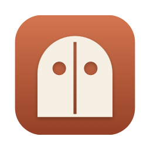
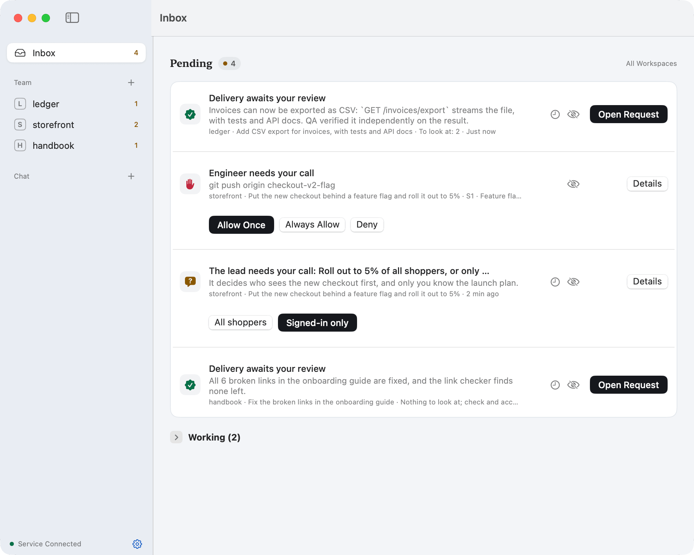
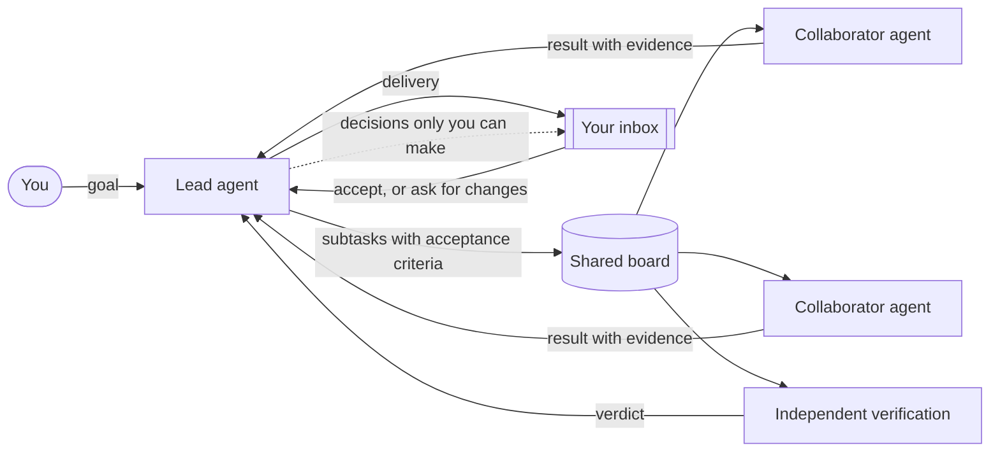
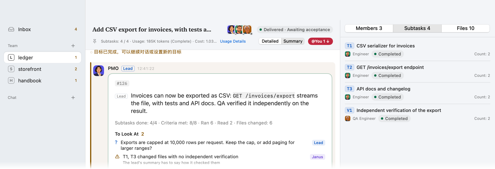
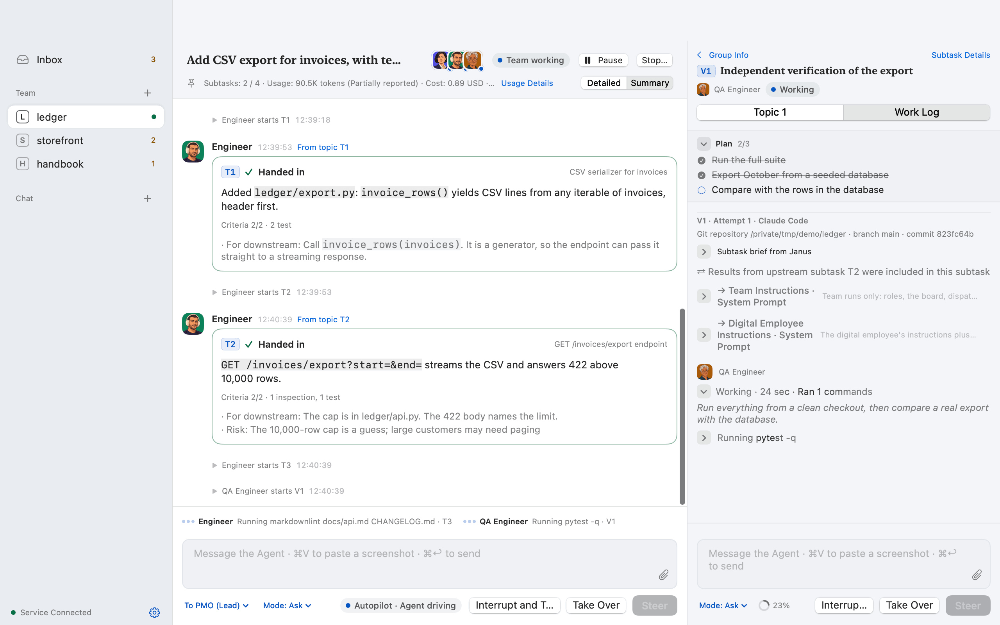
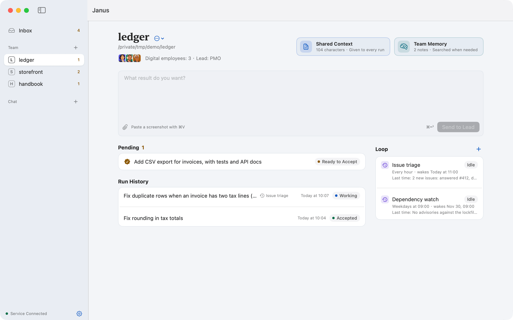

<div align="center">



# Janus

**Creation challenged, Perfection forged.**

<sub>Joint Adversarial Network for Unified Software</sub><br>
<sub>Local-first · Multi-agent · Replayable</sub>

[](https://github.com/duoyuli/Janus/releases/latest)
[](https://github.com/duoyuli/Janus/actions/workflows/ci.yml)


[English](README.md) · [中文](README.zh-CN.md)

**[Download](https://github.com/duoyuli/Janus/releases/latest)** · [Quick start](#quick-start) · [Documentation](docs/index.md) · [Changelog](CHANGELOG.md)

</div>

> A gate has two faces. One looks forward, to what can be built. The other looks back, at what must hold.

Janus turns your coding agents into a team that works on your Mac. You give a goal to a lead agent. It does the work itself or splits it among digital employees, checks what comes back, and delivers. Only the decisions that are yours to make reach you, and every session, subtask, approval and delivery is recorded as an event you can replay.

<p align="center">
  <picture>
    <source media="(prefers-color-scheme: dark)" srcset="docs/assets/screenshots/inbox-en-dark.png">
    
  </picture>
</p>
<p align="center"><sub>The inbox: what is waiting on you, from every workspace. A delivery to accept, a command an agent wants to run, a question only you can answer.</sub></p>

## Why Janus

One coding agent is a tool. Run four at once and you become their manager. You carry one agent's output to another for review. You decide who fixes what the reviewer found. You restart the one that stalled, keep two of them from editing the same file, and wake them up when their quota comes back.

The models are good enough. What is missing is the organization around them: someone who owns the goal, a place where work and questions are visible, a rule for what reaches you, and a way to check the result before it lands. Janus is that organization.

The name is the Roman god of gates, with one face turned toward what is being created and one toward what has been done. Joint Adversarial Network for Unified Software is also how Janus works: what one agent creates, another examines, and only what holds up is delivered.

## How it works



1. **You give a goal** in a workspace: a local directory and a team of digital employees, one of them the lead agent. Each employee is bound to Codex or Claude Code, and one team can mix the two.
2. **The lead agent drives the goal** with `/goal`. If the goal is small, it does the work in its own session. Otherwise it submits subtasks, with an assignee, dependencies and acceptance criteria for each, and Janus validates them before they run.
3. **Collaborator agents do the subtasks**, each in its own session. Progress, blockers and questions go on the shared board. They do not message each other; everything goes through the lead agent. Once it has delegated, the lead agent only coordinates: it sends work back, reassigns it, or checks the results, and never takes the work over.
4. **The lead agent delivers.** You accept the result, or ask the lead agent for changes and get a new delivery.

## Highlights

### Checked before it lands

Every subtask carries acceptance criteria. The agent that did it answers each one with evidence and says how it knows: a test it ran, a command it ran, code it read, or reasoning alone. Janus sends back a result that leaves a criterion unanswered. The lead agent can also assign an independent verification, done by another employee who is given the diff and returns a verdict.

The delivery puts the lead agent's conclusion first, then counts what was run and what was only claimed, then lists what needs your eyes. Each item says where it comes from: a question the lead agent left for you, or something Janus found itself, such as a criterion that was not met, a result that does not match the directory, a subtask that changed files without independent verification, or a file the lead agent edited on its own.

<p align="center">
  <picture>
    <source media="(prefers-color-scheme: dark)" srcset="docs/assets/screenshots/delivery-en-dark.png">
    
  </picture>
</p>
<p align="center"><sub>A delivery: the conclusion, how the criteria were checked, and what to look at, labeled by who raised it.</sub></p>

### You decide only what is yours

The lead agent settles technical choices and trade-offs itself. Approvals, decisions the lead agent hands to you, and deliveries waiting for acceptance reach your inbox, from every workspace. Choices are answered in place, what nobody is blocked on can wait until later, and anything can be ignored.

You can step into any agent's session at any time to steer it or take over. The session shows the agent's plan, its thinking, each tool call and how much of its context is used.

<p align="center">
  <picture>
    <source media="(prefers-color-scheme: dark)" srcset="docs/assets/screenshots/session-en-dark.png">
    
  </picture>
</p>
<p align="center"><sub>A collaborator agent at work on an independent verification. Steer it, or take over.</sub></p>

### From a run to a Loop

A run is one goal, from start to delivery. A Loop wakes a workspace's lead agent on a schedule you set. It looks around, answers what a sentence can answer, and dispatches what needs changing as new runs. Each run sees its goal through on its own; when it ends, the Loop wakes to look at the result. It asks you only what only you can decide, and everything it does lands in your inbox.

Runs never depend on each other, and there is no time or token budget. Tokens, cost and context are shown for every run and subtask, never capped. The only limit is the machine: by default up to 8 runs work at once and up to 12 agent processes stay open. The rest wait in a queue and start as slots free up.

<p align="center">
  <picture>
    <source media="(prefers-color-scheme: dark)" srcset="docs/assets/screenshots/workspace-en-dark.png">
    
  </picture>
</p>
<p align="center"><sub>A workspace: its team, the goal box, what is pending, its Loops and the run history.</sub></p>

### And the rest

- **Your machine stays yours.** Janus never writes your own agent configuration. On a Git repository, each run works in its own worktree, started from your `HEAD`, and each delivery fast-forwards the branch you were on to its result. Janus never leaves a half-done merge in your checkout or overwrites your uncommitted changes. Agents see a mirror of your home directory, so `gh`, SSH and your other tools keep working, while the paths you hide (by default, other agents' configuration and high-risk credentials) stay out of reach.
- **Replayable by default.** Every session, orchestration step, approval, artifact and delivery is an event, so a run can be inspected and resumed instead of reconstructed from memory. The audit log replays a run to any event.
- **Native permissions.** Each agent keeps its own permission modes. Janus adds no second switchboard. An employee with no mode set starts in Codex's Full access or Claude Code's Bypass permissions, so goals run without stopping for approvals.
- **A team that learns the project.** A workspace has shared context that every run starts from, and a team memory: notes agents keep in one run for the runs after them, each marked with who wrote it and where.
- **One library for skills and MCP servers.** Skills and MCP servers are kept once and reach every employee through a single skill and a single MCP server per session. No agent configuration file is written.

## Built the same way

Janus is developed by agents. Its own changes are written, reviewed and merged by coding agents working under [AGENTS.md](AGENTS.md). Each rule in its pre-merge checklist comes from something that went wrong. For example, a run once deleted files inside the repository, and a collaborator agent once impersonated the lead agent on the board. Each of those incidents is recorded in [LESSONS.md](LESSONS.md). Every change ends with `just e2e`, which runs every user journey on a real build of the service and the app and checks what each page shows against the service's own records.

## Core concepts

| Concept | What it means |
| --- | --- |
| Agent | A launchable coding agent, Codex or Claude Code in this version, with its own configuration directory and credentials. |
| Employee | A digital employee: an agent bound to a name, avatar, responsibilities, instructions, model, reasoning effort and permission mode. Its instructions go into the agent's system layer. Employees are managed in groups: move a whole group to another agent, export it as Markdown files, or ask the default Recruiter to design a group with you in a chat. |
| Lead agent | The agent in charge, played by an employee with **Can Be Lead** turned on and bound to Codex or Claude Code. It drives the goal with `/goal`, decides what to do itself and what to delegate to collaborator agents, checks the results and delivers. Loops are run by it too. |
| Collaborator agent | Any other employee on the team. It takes the subtasks the lead agent delegates. |
| Library | Skills and MCP servers, kept once and given to every employee. Each session gets one skill, `janus-skills`, a catalog the agent searches when it needs a skill, and one MCP server, `janus-tools`, which starts or connects the real servers on first use. No agent configuration file is written. Import skills from a GitHub repository, copy them from a local folder, or write them in the app; add MCP servers with a form or pasted JSON, or in one click from Recommended. |
| Workspace | A local directory, a team of employees with one lead agent, and shared context: background that every run and Loop in the workspace starts from. |
| Team memory | Notes agents keep in a workspace's runs for the runs after them: how to run the tests, a trap they fell into, why something is the way it is. Each note says who wrote it in which run; you can edit or delete it, or add it to the shared context. After a few delivered runs the lead agent merges duplicates and removes what is out of date. |
| Run | A goal submitted in a workspace, followed from creation through delivery and acceptance. |
| Subtasks and board | The work the lead agent delegates, each with an assignee, dependencies and acceptance criteria. Janus validates them before they run. Progress, blockers and questions go on the shared board. |
| Loop | A workspace's lead agent on a schedule: presets or any standard five-field cron expression, in your time zone. It dispatches runs and asks you questions, and both land in the inbox. |
| Chat | A one-to-one conversation with a single employee, outside any workspace, in a fresh directory that is deleted with the chat. It uses the same session view as a run: steer, take over, approve, paste images, switch model and mode. |
| Inbox | Everything waiting on you across all workspaces. Choices are answered in place, what nobody is blocked on can wait until later, and anything can be ignored. |

## Scope

Janus is built for one machine and one person. Runs change the directory you choose (or a worktree that is merged back into your branch when the run is delivered). Agents can read and write everything in your home directory except the paths you hide, the service has no authentication, and there is no OS-level sandbox. Read the [security boundaries](docs/operations/20261031-security.md) before pointing it at a real project.

## Quick start

### The macOS app (recommended)

Janus needs an Apple silicon Mac (M series) on macOS 15 or later; it supports the three latest major versions of macOS (15, 26 and 27). The app bundles the Janus service and Node.js, so neither Rust nor Node is required, and the Codex and Claude Code adapters bundle their CLIs.

1. Download `Janus-<version>.dmg` from [GitHub Releases](https://github.com/duoyuli/Janus/releases) and drag Janus into Applications.
2. On first launch, macOS may say the developer cannot be verified (the package is not signed with an Apple certificate). Open System Settings › Privacy & Security and choose Open Anyway.
3. Follow the macOS permission checklist Janus shows. One button starts sequential guidance for Full Disk Access, App Management and Screen Recording; you still switch each one on in macOS, and Janus detects the status of all three.

The app ships with its own Janus service and works out of the box. If you already run Janus with `just start`, the app connects to that service. See [Deployment](docs/operations/20261031-deployment.md#macos_app). Later releases install from Settings › General › Updates: only the changed parts download, and the app restarts into the new version.

Press ⌘, to open Janus Settings. In General › Language, choose Follow System, 简体中文, or English. Changes take effect immediately and persist across launches.

The permission checklist appears after the first installation, and again when Janus’s signing identity changes (for example when upgrading from a release before 2026.11.18.5); updates with the same signature keep the permissions you granted. It is also available under Settings › General › macOS Permissions. Agents started by a separate service may need their own authorization. See [macOS permissions](docs/architecture/20261031-frontend.md#macos_permissions).

### From source

#### Prerequisites

- The Rust toolchain and Cargo (edition 2024), Swift 6 (Xcode or the Command Line Tools), and [just](https://github.com/casey/just).
- Node.js 22.19 or later, and the npm that ships with it.
- Built-in adapters bundle the Codex and Claude Code CLIs.
- The first use of an agent needs network access to download its ACP adapter.

#### Install and start

From the repository root:

```sh
just install   # build and install to ~/.janus/bin/janus
just start     # run as a service: starts automatically at login (macOS); just run runs it in the foreground
```

Then `just mac` runs the app from source and connects it to this service; `just dmg` builds `Janus.app` and a DMG locally. For development, `just dev` starts the service from source. Running `just` without arguments lists every command.

### First run

1. Add an agent under Settings › Employees and run the configuration check. Its runtime downloads at this step and Janus keeps it up to date on its own; when you need an older version, switch back from the runtime line on the agent's card.
   To connect Claude through an API, select **Custom API** under authentication, then click **Insert Template** or paste your `export KEY=value` lines for the endpoint, token, and models.
2. Bind employees to agents on the same page, choose a model and permission mode, and turn on **Can Be Lead** for the ones that should lead. If the default employees don't fit your work, choose **Ask the Recruiter…**, talk through your trade and what needs doing, and create the employees it designs once you have reviewed them in the chat.
3. Create a workspace: choose a directory, pick its team, and choose its lead agent.
4. Enter a goal on the workspace home page and choose **Send to Lead**.

The repository holds code only. Janus data, adapters, configuration, and logs live in `~/.janus`; see [Deployment](docs/operations/20261031-deployment.md).

`examples/calc/` is a minimal example project. Copy it outside the repository (for example `cp -R examples/calc ~/calc`) before using it as a workspace. Make the copy a Git repository with one commit (`git init && git add -A && git commit -m init`): each run then works in its own worktree, keeps a diff, and when it is delivered Janus commits the result and fast-forwards the branch you were on, so it lands in your directory. Without Git, the lead agent and subtasks edit the directory in place and keep no diff; if another run is already working there, Janus warns you but does not stop you. Verify it with `python3 -m unittest discover -s examples/calc`.

## Documentation

Engineering documentation starts at [docs/index.md](docs/index.md) and is organized into seven areas:

| Area | Contents |
| --- | --- |
| [Architecture](docs/architecture/index.md) | Components and process model, storage layout, ACP adapter management, macOS app |
| [Domains](docs/domains/index.md) | Run lifecycle, goal mode and shared board, agents / employees / workspaces and permission modes, resource library |
| [Interfaces](docs/interfaces/index.md) | HTTP API, events, board MCP tools, ACP integration, configuration |
| [Operations](docs/operations/index.md) | Deployment, CI and releases, runbook, testing, security boundaries |
| [Decisions](docs/decisions/index.md) | Architecture decision records (ADRs) |
| [Research](docs/research/index.md) | Reports on external multi-agent and agent-team work, with takeaways for this project |
| [Review](docs/review/index.md) | Code review and audit reports |

Every release and what it changed, fixes included, is in the [changelog](CHANGELOG.md). Agents working in this repository should read [AGENTS.md](AGENTS.md) first (`CLAUDE.md` points to the same file).

The screenshots above show demonstration data in the real app.
