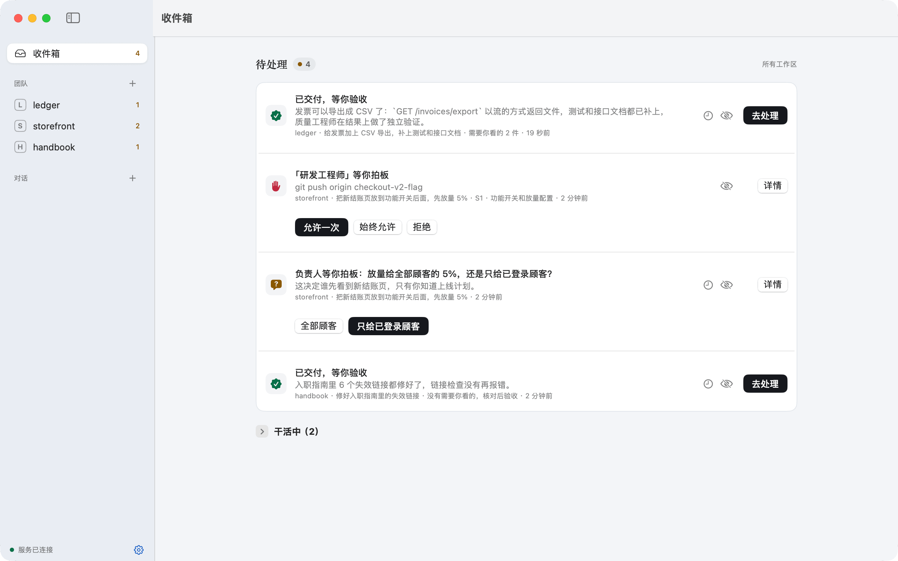
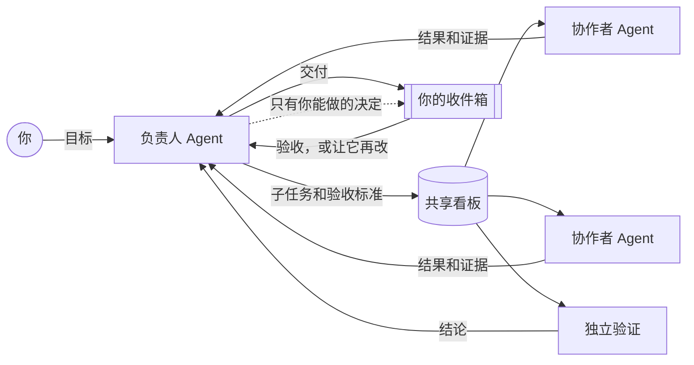
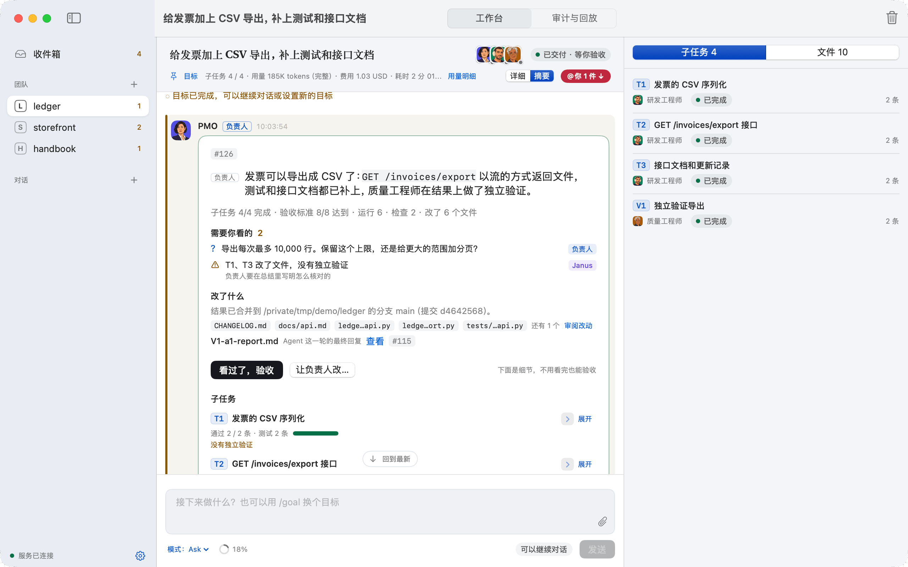
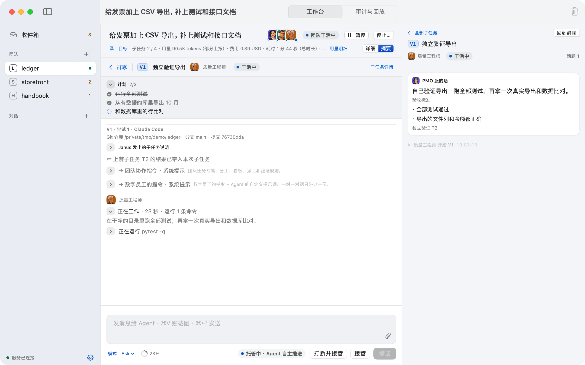
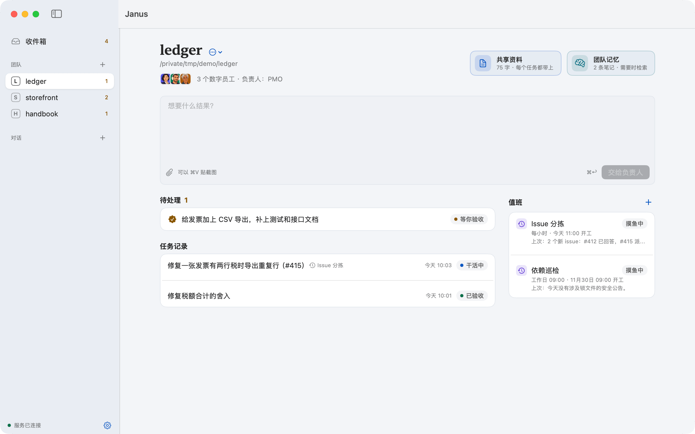

<div align="center">


# Janus

**始于构想，淬于交锋**

<sub>本地优先 · 多智能体 · 可回放</sub>

[](https://github.com/duoyuli/Janus/releases/latest)
[](https://github.com/duoyuli/Janus/actions/workflows/ci.yml)


[English](README.md) · [中文](README.zh-CN.md)

**[下载](https://github.com/duoyuli/Janus/releases/latest)** · [快速开始](#快速开始) · [文档](docs/index.md) · [更新记录](CHANGELOG.md)

</div>

> 门有两面。一面向前，望向尚未建成之物；一面向后，审视必须成立之事。

Janus 把你的编码 Agent 组织成一支在你的 Mac 上工作的团队。你把目标交给负责人 Agent，它自己动手，或者把工作分给数字员工，检查交回来的结果，然后交付。只有该你拍板的事才会找到你，每一次会话、子任务、审批和交付都记成事件，可以回放。

<p align="center">
  <picture>
    <source media="(prefers-color-scheme: dark)" srcset="docs/assets/screenshots/inbox-zh-dark.png">
    
  </picture>
</p>
<p align="center"><sub>收件箱：各个工作区里等你处理的事。一个等验收的交付，一条 Agent 想执行的命令，一个只有你能回答的问题。</sub></p>

## 为什么是 Janus

一个编码 Agent 只是一件工具。同时开四个，你就成了它们的经理。你要把一个 Agent 的结果交给另一个审查，决定审查出的问题由谁来改，重启卡住的 Agent，避免两个 Agent 同时改一个文件，还要等额度恢复后叫它们接着干。

模型已经够聪明了，缺的是围绕它们的组织。目标要有人负责，工作和问题要有地方摆出来，哪些事该找你要有规矩，结果落地前要有人检查。Janus 就是这个组织。

Janus 是罗马神话中的门神，一张面孔朝向未来的创造，一张回望做完的工作。这也是 Janus 的工作方式：一个 Agent 做出的成果，要经过另一方的检查，经得住的才交付。

## 怎样工作



1. **你提出目标**。目标提在工作区里：一个本机目录，加上一支数字员工团队，其中一名是负责人 Agent。每名数字员工绑定 Codex 或 Claude Code，同一支团队里可以两种都有。
2. **负责人 Agent 推进目标**。它用 `/goal` 推进：目标小，在自己的会话里直接做完；目标大，就提交子任务，写明由谁做、依赖和验收标准，Janus 先校验再执行。
3. **协作者 Agent 做子任务**，每个子任务一个会话。进展、阻塞和提问写在共享看板上。协作者 Agent 之间不直接通讯，一切都经过负责人 Agent。派出子任务后，负责人 Agent 只做调度：打回返工、改派，或者检查结果，不再自己接手。
4. **负责人 Agent 交付**。你验收结果，或者让负责人 Agent 再改，改完再交付一次。

## 亮点

### 结果落地前有人检查

每个子任务都带验收标准。做子任务的 Agent 逐条回答，给出证据，并说明证据是怎么来的：跑了测试、执行了命令、读了代码，还是只靠推断。漏答标准的结果，Janus 会发回去补。负责人 Agent 还可以安排独立验证：由另一名数字员工拿着 diff 核对，给出结论。

交付卡片最上面是负责人 Agent 的结论，接着是一行数字，写明哪些标准是运行验证的、哪些只是说法，然后列出需要你看的事。每一条都标明来源：负责人 Agent 留给你的问题，或者 Janus 自己查出来的事，例如没通过的标准、结果和目录对不上、改了文件却没有独立验证、负责人 Agent 自己改的文件。

<p align="center">
  <picture>
    <source media="(prefers-color-scheme: dark)" srcset="docs/assets/screenshots/delivery-zh-dark.png">
    
  </picture>
</p>
<p align="center"><sub>一次交付：结论、验收标准是怎么核对的、需要你看的事（标明是谁提出的），以及改了什么。</sub></p>

### 只有你的决定才找你

技术选型和取舍由负责人 Agent 自己定。审批、负责人 Agent 交给你的决定、等验收的交付，都从各个工作区汇总到收件箱。选择题直接在收件箱里回答，没有人在等的可以稍后再看，不想管的可以忽略。

每个任务就是一个群。负责人怎样派活、谁开了工、交了什么、哪里返工、哪里卡住，都按时间出现在群里；组员和负责人之间的来回留在每个子任务的话题里，不在群里刷屏。等你处理的事在群里 @你，就地处理。你随时可以把任何一名协作者的工作记录展开到整个页面，插话或接管，里面能看到它的计划、思考、每一次工具调用和上下文用了多少。

<p align="center">
  <picture>
    <source media="(prefers-color-scheme: dark)" srcset="docs/assets/screenshots/session-zh-dark.png">
    
  </picture>
</p>
<p align="center"><sub>从话题展开一名协作者 Agent 的工作记录：它正在做独立验证，可以插话，也可以接管。</sub></p>

### 从任务到值班

任务是一个目标，从开始到交付。值班让工作区的负责人 Agent 按你定的时间表醒来，看一眼，一两句话能答的直接答，要改东西的派成新任务。派出的任务自己做完、自己验收，结束时再叫醒值班来看结果；只有你能决定的才问你，结果都到收件箱。

任务之间没有依赖，也没有时间和 token 预算。每个任务和子任务的 token、费用和上下文用量都看得到，但不设上限。唯一的限制是机器本身：默认最多 8 个任务同时进行、最多 12 个 Agent 进程同时打开，其余的排队，空出位置后依次开始。

<p align="center">
  <picture>
    <source media="(prefers-color-scheme: dark)" srcset="docs/assets/screenshots/workspace-zh-dark.png">
    
  </picture>
</p>
<p align="center"><sub>一个工作区：团队、目标输入框、待处理的事、值班和任务记录。</sub></p>

### 其他

- **不动你的环境。** Janus 从不改你自己的 Agent 配置。在 Git 仓库上，每个任务在自己的 worktree 里进行，从你的 `HEAD` 开始；每次交付时把你原来所在的分支快进到结果。Janus 不会在你的目录里留下做了一半的合并，也不会覆盖你没提交的改动。Agent 看到的是你用户目录的镜像，`gh`、SSH 和其他工具照常能用；你挡住的路径（默认是其他 Agent 的配置和高危凭据）它们看不到。
- **默认可回放。** 每一次会话、编排、审批、产物和交付都是事件，任务可以检查和从中断处继续，不用靠记忆重建。审计日志可以把任务回放到任意一条事件。
- **原生权限。** 每个 Agent 保留自己的权限模式，Janus 不再叠加一套开关。没有指定模式的数字员工，Codex 以 Full access、Claude Code 以 Bypass permissions 启动，目标执行中不会停下来等审批。
- **越用越懂项目的团队。** 工作区有共享资料，每个任务都从它开始；还有团队记忆：Agent 在一个任务中记下、之后的任务会读到的笔记，每条记着是谁在哪个任务里写的。
- **Skill 和 MCP 只保存一份。** 资源库里的 Skill 和 MCP 服务器给所有数字员工，每个会话只经一个 Skill 和一个 MCP 服务器拿到它们，不写任何 Agent 的配置文件。

## Janus 也是这样造出来的

Janus 由 Agent 开发：仓库的改动由编码 Agent 按 [AGENTS.md](AGENTS.md) 编写、审查和合并。合并前检查的每一条都来自一次真实的问题，例如任务删掉过仓库里的文件、协作者 Agent 在看板上冒充过负责人 Agent，来由记在 [LESSONS.md](LESSONS.md)。每次改动最后都运行 `just e2e`：在真实构建的服务和应用上跑完每条用户旅程，并把页面上的数据和服务端的记录逐项核对。

## 核心概念

| 概念 | 说明 |
| --- | --- |
| Agent | 一个可启动的编码 Agent，当前版本是 Codex 或 Claude Code，各有独立的配置目录和凭据。 |
| 数字员工 | 绑定一个 Agent，指定名字、头像、职责、指令、模型、推理强度和权限模式。指令放在 Agent 的系统层。数字员工按分组管理，可以整组换 Agent、导出成 Markdown 文件，也可以请默认的「招聘顾问」在对话里为你设计一组。 |
| 负责人 Agent | 带队的 Agent，由一名开启「可以担任负责人」的数字员工担任，绑定 Codex 或 Claude Code。它用 `/goal` 推进目标，决定自己做还是派给协作者 Agent，检查结果后交付。值班也由它执行。 |
| 协作者 Agent | 团队里负责人 Agent 以外的数字员工，接负责人 Agent 派出的子任务。 |
| 资源库 | Skill 和 MCP 服务器只保存一份，给所有数字员工。每个会话只拿到一个 Skill `janus-skills`（一份目录，Agent 需要时在里面查找）和一个 MCP 服务器 `janus-tools`（背后的服务器在第一次用到时由 Janus 启动或连接），不写任何 Agent 的配置文件。Skill 可以从 GitHub 仓库导入、从本机文件夹复制或在应用中写；MCP 服务器填写表单、粘贴 JSON，或从「推荐」一键添加。 |
| 工作区 | 一个本机目录，加上一支数字员工团队（其中一名是负责人 Agent）和共享资料。共享资料是工作区的长期背景，这个工作区里的每个任务和值班都从它开始。 |
| 团队记忆 | 工作区里 Agent 在任务中记下、之后的任务会读到的笔记：怎么跑测试、踩过的坑、为什么这样做。每条记着是谁在哪个任务里写的，你可以改、删，或把一条加进共享资料；攒够几个交付的任务后，负责人 Agent 会合并重复的、删掉过时的。 |
| 任务 | 在工作区中提交的一个目标，从创建到交付、验收的全过程。 |
| 子任务与看板 | 负责人 Agent 派出的工作，每项写明由谁做、依赖和验收标准，Janus 先校验再执行；进展、阻塞和提问写在共享看板上。 |
| 值班 | 按时间表醒来的负责人 Agent：预设选项或任意标准五段 cron 表达式，按本机时区。它派出的任务和提给你的问题都到收件箱。 |
| 对话 | 和一名数字员工单独对话，不属于任何工作区，在新建的目录里工作，删除对话时目录一起删除。会话视图和任务相同：插话、接管、审批、粘贴图片、切换模型和模式。 |
| 收件箱 | 所有工作区里待处理的事。选择题直接在收件箱里回答，没有人在等的可以稍后再看，不想管的可以忽略。 |

## 适用范围

Janus 是单机、单用户的工具。任务修改你选择的目录（或者在 worktree 里修改，交付时合回你的分支）；除了你挡住的路径，Agent 能读写你用户目录里的一切；服务只让本机的 Janus 应用和在 Mac 上扫码配对过的浏览器、手机进来，局域网里是明文 HTTP；没有操作系统级沙箱。投入真实项目前，请先阅读[安全边界](docs/operations/20261031-security.md)。

## 快速开始

### 用 macOS 应用（推荐）

需要 Apple 芯片（M 系列）的 Mac、macOS 15 以上：Janus 只支持最近三个 macOS 大版本（15、26、27）。安装包自带 Janus 服务和 Node.js，不需要 Rust 和 Node；Codex 和 Claude Code 的适配器自带对应的 CLI。

1. 在 [GitHub Releases](https://github.com/duoyuli/Janus/releases) 下载 `Janus-<版本>.dmg`，把 Janus 拖进「应用程序」。
2. 第一次打开时，macOS 会提示无法验证开发者（安装包没有用 Apple 证书签名）：到「系统设置 › 隐私与安全性」点「仍要打开」。
3. 按应用显示的 macOS 权限引导授权。一键按顺序处理完整磁盘访问、应用程序管理和屏幕录制；授权仍需在系统界面开启，三项的状态都由 Janus 自动检测。

应用自带 Janus 服务，打开即用；如果你已经用 `just start` 运行了 Janus，应用会直接连接它。详见[部署方案](docs/operations/20261031-deployment.md#macos_app)。之后的新版本在「设置 › 通用 › 更新」中安装：只下载变化的部分，应用重启后进入新版本。

按 ⌘, 打开 Janus 设置，在「通用 › 语言」中选择「跟随系统」「简体中文」或「English」。切换立即生效，重新打开应用时保留选择。

权限引导在首次安装后自动显示，Janus 的签名身份变化后（例如从 2026.11.18.5 之前的版本升级上来）会再次显示；授权之后，同一签名的更新会保留这些权限。引导也可以在「设置 › 通用 › macOS 权限」继续。独立服务启动的 Agent 可能需要单独授权，见 [macOS 权限](docs/architecture/20261031-frontend.md#macos_permissions)。

### 从源码运行

#### 前置条件

- Rust 工具链和 Cargo（edition 2024）、Swift 6（Xcode 或命令行工具），以及 [just](https://github.com/casey/just)。
- Node.js 22.19 或更高，以及随它安装的 npm。
- 内置适配器自带 Codex 和 Claude Code 的 CLI。
- 第一次使用某个 Agent 时需要网络，用来下载它的 ACP 适配器。

#### 安装并启动

在仓库根目录：

```sh
just install   # 编译并安装到 ~/.janus/bin/janus
just start     # 以服务方式启动：登录后自动运行（macOS）；也可以用 just run 在前台运行
```

然后用 `just mac` 从源码运行应用，它会连接这个服务；`just dmg` 在本机打包出 `Janus.app` 和 DMG。开发时用 `just dev` 从源码启动服务。`just` 不带参数会列出全部命令。

### 首次使用

打开应用后按以下顺序配置：

1. 在「设置 › 数字员工」中添加 Agent，并运行配置检查。它需要的运行组件会在这一步自动下载，之后由 Janus 自动升级；需要旧版本时，在 Agent 卡片的运行组件一行切回历史版本。
   通过 API 接入 Claude 时，在「认证」中选择「自定义 API」，点「填入模板」或直接粘贴多行 `export KEY=value`，一起设置网关地址、令牌和模型。
2. 在同一页为数字员工绑定 Agent，选择模型和权限模式，需要它带队时开启「可以担任负责人」。默认员工不合适时，点「找招聘顾问…」聊聊你的行业和要做的事，它设计的一组数字员工在对话里确认后创建。
3. 新建工作区：选择目录，挑好团队，指定负责人 Agent。
4. 在工作区首页输入目标，点「交给负责人」。

仓库只放代码。Janus 的数据、适配器、配置和日志都在 `~/.janus`，详见[部署方案](docs/operations/20261031-deployment.md)。

`examples/calc/` 是一个最小示例项目。用作工作区前先把它复制到仓库之外（例如 `cp -R examples/calc ~/calc`），并在复制出来的目录里建一个 Git 仓库、提交一次（`git init && git add -A && git commit -m init`）：这样每个任务都在自己的 worktree 里进行，留下 diff，交付时 Janus 把结果提交并快进到你所在的分支，直接出现在你的目录里。不是 Git 仓库也能用，只是负责人 Agent 和子任务直接修改这个目录，也没有 diff；同一个目录上已有进行中的任务时，Janus 只提醒、不阻止。可以用 `python3 -m unittest discover -s examples/calc` 验证。

## 文档

工程文档从 [docs/index.md](docs/index.md) 开始，按用途分为七类：

| 分类 | 内容 |
| --- | --- |
| [架构](docs/architecture/index.md) | 组件与进程模型、存储布局、ACP 适配器管理、macOS 应用 |
| [领域](docs/domains/index.md) | 任务（Run）的生命周期、目标模式与共享看板、Agent / 数字员工 / 工作区与权限模式、资源库 |
| [接口](docs/interfaces/index.md) | HTTP API、事件、看板 MCP 工具、ACP 集成、配置 |
| [运维](docs/operations/index.md) | 部署方案、CI 与发布、运行手册、测试、安全边界 |
| [决策](docs/decisions/index.md) | 架构决策记录（ADR） |
| [研究](docs/research/index.md) | 外部多 Agent 协作与 Agent Team 的观察报告，以及给本项目的借鉴建议 |
| [审查](docs/review/index.md) | 代码审查和审计报告 |

每个版本的变化（包括缺陷修复）都记在[更新记录](CHANGELOG.md)里。在本仓库工作的编码 Agent 先读 [AGENTS.md](AGENTS.md)（`CLAUDE.md` 指向同一文件）。

上面的截图是真实应用里的演示数据。
