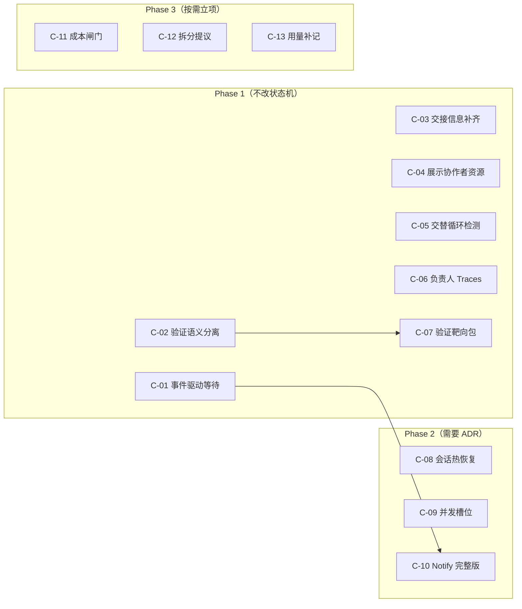

# Janus 多 Agent 协作改造方案

> 上级索引：[审查文档](index.md)

综合审查 [Codex 日志分析](20261118-agent_collaboration_log_analysis.md)和 [Antigravity 架构审查](20261118-multi_agent_collaboration.md)两份报告后形成的可落地方案。审查日期：2026-11-18。基线提交：`57a35dd`。本方案的代码位置对照基线提交核对；运行数据和用量数字取自两份源报告，没有重新运行任务，各自的可信程度见[两份报告的审查评估](#report_review)。

## 导航

- [两份报告的审查评估](#report_review)：判断两份源报告各自可信到什么程度时阅读。
- [综合改造方案](#plan)：查某个 C 改造项的根因、方案和验收时阅读。
- [实施顺序与依赖关系](#order)：安排改造先后时阅读。
- [验证策略](#validation)：设计改造的验证时阅读。
- [文档影响](#doc_impact)：改造落地后同步文档时阅读。

## 两份报告的审查评估

### Codex 报告（日志分析）

**视角与方法**：从 5 次真实运行的事件日志和原生会话出发，逐请求归因 token 消耗、等待循环、验证语义和用量缺口。**数据扎实**，380 次 `janus.wait` / 260 次空返回 / 38.12 M token 无新增信息后继续等待——这些数字可在冻结快照上复算。

**有效发现**：
1. PMO 空等待循环（§1）——代码证据确凿：`board.rs:208` 的 45 秒上限 + 500ms 轮询 + `lead.rs:667` 要求无消息就再调用，直接导致了 480 次仅执行等待的模型请求。
2. 验证 `passed` 语义歧义（§2）——`lifecycle.rs:437` 用 `TaskStatus::Succeeded` 判断验证是否通过，QA 完成了检查但发现阻断问题时，任务仍可标为成功，`passed: true` 不代表产物合格。反过来，只读 QA 发现问题报 `false` 后被要求「修复重验」也是同一个语义混淆的反面。**两个方向的问题都有事件编号支撑。**
3. 异常会话用量缺失（§3）——4 个完全未上报的会话合计 40.85 M token，说明角色占比和成本分析的基础数据不完整。
4. 验收标准未同步到执行者（§4）——PM 的 SC-1 至 SC-9 没有成为作者的验收契约。
5. 局部修订触发全面复验（§5）——一条证据等级修正引发 2.5 M token 的完整重新验收。
6. 数值证据在转述中丢失口径（§6）——「5 次累计 15,160」被描述为单次数字。

**审查意见**：
- §1 的 38.12 M 保守估计方法合理，但报告自己也指出不能全视为可删除消耗——正常接收完成消息仍有价值。**改造方案应区分「可消除的空转」和「必要的事件接收」。**
- §2 和 §4 的分析准确，但建议的「三个独立信息」方案过于理想化。Janus 的结构化结果已经有 `checks` 数组，实际问题出在交付记录和调度对 `checks` 的使用不够——验证任务的 `passed` 应该看 `checks` 内容而不仅是 `TaskStatus`。
- §7 的角色启用策略部分偏向运营建议，对代码改造指导有限，但方向正确。

### agy 报告（架构审查）

**视角与方法**：从代码快照出发，逐模块走读编排链路，交叉对照业内产品（OpenAI Hosted Multi-Agent、Google Antigravity /swarm、Microsoft Magentic）和学术研究（MAST、Coordination Tax、Parallel Agent Teams），列出 MA-01 至 MA-07 共 7 个结构性瓶颈。

**有效发现**：
1. MA-01（单角色单成员 1:1 绑定）——`workspaces.rs:100-108` 确实把每个角色展开为单个 `Member`，`lifecycle.rs:186` 的 `busy` 集合限制每成员一个在跑任务。代码证据准确。
2. MA-02（每次尝试结束即杀会话）——`attempts.rs:400` 的 `close_session` 确认；已有的 `session/load` 能力（`attempts.rs:178-190`）证明基础设施就绪。
3. MA-03（`team_lines_vec` 不暴露资源、wait 短超时）——`lead.rs:748-765` 确实只输出 id/名字/角色/desc/agent/model/权限，没有 `m.resources`。与 Codex 报告 §1 的日志数据互相印证。
4. MA-04（上游交接仅 300 字符摘要）——核对代码，`attempts.rs:112-129` 中上游 `r.risks` 只有 `r.risks.len()` 写进 `handoff` 事件，下游提示词里确实看不到风险内容。**但 300 字符限制的说法需要修正**：代码中 `INLINE_SUMMARY` 的值是在 `short()` 中截断，实际摘要长度由模型回复决定，`short` 是显示层截断。下游拿到的是完整 `r.summary`（`attempts.rs:126` 的 `line` 变量用了 `short`，但 `handoff` JSON 字段用了完整 `r.summary`）。真正的问题是 `risks` 和接口细节没进下游提示词。
5. MA-05（负责人编辑不进 Traces）——`turn.rs:557-559` 的 `ctx.task.is_some()` 条件确认，负责人 `ctx.task` 为 `None`。
6. MA-06（协作者缺少拆分提议通道）——准确识别了 4 轮提问上限（`attempts.rs:310-313`）的刚性约束。
7. MA-07（watch_call 只检测连续相同调用）——`lifecycle.rs:344-359` 确认只比较紧邻上一次。

**审查意见**：
- MA-04 中「截断到 300 字符」的说法不完全准确（见上文），但核心问题成立。
- MA-01（并发槽位）和 MA-02（会话热恢复）是中到大的改动，报告正确建议需要 ADR。
- 业内对照部分引用了合理的参考，但直接套用外部系统的收益比例不可取——报告本身也做了这个声明。
- DOC-01 和 DOC-02 的文档漂移发现准确，可顺带清理。

### 两份报告的交叉验证

| 主题 | Codex 日志证据 | agy 代码证据 | 交叉验证结论 |
| --- | --- | --- | --- |
| 空等待循环 | 380 次 wait / 260 次空返回 / 38.12 M 无新增后继续等待 | `board.rs:208` 45 秒 + 500ms 轮询 + `lead.rs:667` 再调用指令 | **确认**，日志数据与代码机制完全吻合 |
| 验证语义歧义 | 性能报告 QA 发现 2 倍高估仍标 `passed: true`；研究报告 QA 报 `false` 被要求修复 | `lifecycle.rs:437` 用 `TaskStatus::Succeeded` 判 `passed` | **确认**，两个方向的问题都有实证 |
| 上游交接信息不足 | 验收标准未同步，SC-1 至 SC-9 到产品验收才对齐 | `attempts.rs:112-129` risks 只传条数 | **确认**，协议层和实践层都印证 |
| 用量统计不完整 | 4 个会话合计 40.85 M 未上报 | 代码中 usage 在会话正常结束时上报，异常中断路径无补报 | **确认**，需要逐请求持久化 |
| 负责人编辑盲区 | 未直接涉及 | `turn.rs:557-559` 负责人编辑不记 Traces | **仅代码发现**，日志中无对应事故，优先级适当降低 |
| 同质角色串行 | 未直接涉及（样本运行角色不同） | `workspaces.rs:100-108` / `lifecycle.rs:186` | **仅代码发现**，对并行代码任务有实际影响 |
| 会话冷启动 | 未直接涉及 | `attempts.rs:400` close + 已有 `session/load` | **仅代码发现**，但缓存命中率下降是已知成本因素 |

---

## 综合改造方案

以下方案按优先级分三个阶段，每个条目给出：问题根因、代码位置、改动方案、验收标准和风险边界。编号 `C-` 表示改造项。

### Phase 1：事件驱动等待 + 验证语义修正 + 交接信息补齐

这三项不改状态机和存储表结构，改动集中在信息拼装、等待逻辑和交付记录的语义层。

---

#### C-01：PMO 事件驱动等待（消除空转循环）

**根因**：`board_wait_inner`（`board.rs:207-228`）用 500ms 定时轮询 SQLite + 45 秒硬超时，负责人被迫反复调用 `janus.wait`，每次触发完整上下文推理。日志证据：5 次运行 480 次仅等待的模型请求，其中 276 次在无新增信息后继续等待，消耗 38.12 M token（96% 是缓存读取）。

**改动方案**：

1. **`board_wait_inner` 改为 `Notify` 唤醒**：在 `Run` 上增加 `board_notify: tokio::sync::Notify`。`emit` 写入看板相关事件（`task.succeeded`、`task.failed`、`question.asked`、`board_post`、`control.*`、`user.*`）时调用 `board_notify.notify_one()`。`board_wait_inner` 的内循环从 `sleep(500ms)` 改为 `tokio::select! { _ = board_notify.notified() => {}, _ = sleep(remaining) => {} }`。

2. **放宽 `timeout_sec` 上限**：`board_tools.rs:57` 的 `maximum` 从 45 改为 180。`board.rs:208` 的 `clamp(1, 45)` 改为 `clamp(1, 180)`，默认值从 40 改为 120。MCP 客户端的 HTTP 请求超时需要同步确认不低于此值（Codex 和 Claude Code 的 MCP 客户端超时默认高于 3 分钟）。

3. **超时返回附带运行中任务脉搏**：超时且无新看板事件时，从内存 `Run.st` 读取每个 `TaskStatus::Running` 任务的 `AgentPhase`、最近工具调用标题、已运行时长和已改文件数，拼一行摘要附在返回文字后。负责人看到的不再只是「没有新消息，可以再调用」，而是「子任务 T1 正在运行测试（已 4 分钟），T2 在读取文件」。

4. **`lead.rs:667` 的指令文案更新**：从「没有新消息就再调用」改为「Janus 有新消息时会立即返回。等待时间较长时返回运行中子任务的进展。继续等待前先判断是否需要干预」。

**代码位置**：
- [board.rs:207-228](https://github.com/duoyuli/Janus/blob/57a35ddc62223b55bd74bf33a1e7d896f78464a9/backend/src/orchestrator/board.rs#L207-L228)（等待循环）
- [board_tools.rs:55-59](https://github.com/duoyuli/Janus/blob/57a35ddc62223b55bd74bf33a1e7d896f78464a9/backend/src/orchestrator/board_tools.rs#L55-L59)（schema 上限）
- [lead.rs:667](https://github.com/duoyuli/Janus/blob/57a35ddc62223b55bd74bf33a1e7d896f78464a9/backend/src/orchestrator/lead.rs#L667)（负责人指令）
- [lifecycle.rs](../../backend/src/orchestrator/lifecycle.rs)（`Run` 结构增加 `board_notify`）

**验收标准**：
- 无看板事件时，负责人模型请求数不超过每分钟 1 次（当前约每 45 秒 1 次）。
- 有看板事件时，负责人在 2 秒内收到（通过 `Notify` 或 `push_board`，取先到者）。
- 超时返回包含运行中任务的 `AgentPhase` 和已运行时长。
- 在已有的脚本化 ACP 测试中，模拟一个 3 分钟的子任务，验证负责人等待期间模型请求数 ≤ 3。

**风险边界**：
- `Notify` 是 `tokio::sync::Notify`，单生产者多消费者语义，`notify_one` 只唤醒一个等待者——负责人同时只有一个 `wait` 在跑，语义匹配。
- 放宽超时不改变 `push_board` 的行为：负责人在做别的事时，`push_board` 仍然通过 steering 注入消息。

---

#### C-02：验证结果语义分离（审查完成 ≠ 产物合格）

**根因**：`lifecycle.rs:437` 用 `v.status == TaskStatus::Succeeded` 计算 `passed`，把「QA 完成了检查」和「被检查产物合格」混为一谈。导致两个方向的错误：(a) QA 发现阻断问题但任务成功，`passed: true`；(b) 只读 QA 如实报 `false`，系统要求它「修复后重验」。

**改动方案**：

1. **在验证任务的结构化结果中区分 `verdict`**：验证任务（`def.verifies.is_some()`）的结构化结果增加可选字段 `verdict`，取值为 `"approved"` / `"rejected"` / `"inconclusive"`。`verdict` 由验证者在 JSON 结果中填写，表示对被验证产物的判定。不填时按现有逻辑从 `checks` 推断（全部 `passed: true` → `approved`，任一 `passed: false` → `rejected`）。

2. **交付记录的 `passed` 改为基于 `verdict`**：`lifecycle.rs:437` 的 `Verification.passed` 从 `v.status == TaskStatus::Succeeded` 改为读 `verdict`。QA 完成检查并发现阻断问题时，任务状态是 `Succeeded`（审查完成），但 `verdict` 是 `rejected`（产物不合格），`passed` 为 `false`。

3. **验证者提示词更新**：`teamwork.rs:180-188` 的 `task_section` 在 `verifies` 分支中增加：「完成检查后，在结构化结果中用 `verdict` 写明判定：`approved`（产物达标）、`rejected`（产物需要修改）或 `inconclusive`（证据不足以判定）。即使发现问题，也请正常提交结果——你的工作是检查和报告，不是修复。」

4. **验证失败后的调度逻辑**：当验证任务 `Succeeded` 但 `verdict == "rejected"` 时，不触发 `retry`（当前不会，因为任务是成功的），而是通过看板消息通知负责人：「独立验证 V1 完成，判定 `rejected`：<摘要>。请安排修复子任务和新的验证。」这与 `teamwork.rs:195-198` 的现有引导一致，只是不再让 QA 被迫修复。

**代码位置**：
- [lifecycle.rs:432-458](https://github.com/duoyuli/Janus/blob/57a35ddc62223b55bd74bf33a1e7d896f78464a9/backend/src/orchestrator/lifecycle.rs#L432-L458)（`Verification` 构造）
- [prompts.rs](../../backend/src/orchestrator/prompts.rs)（`parse_result` 增加 `verdict` 解析）
- [teamwork.rs:180-188](https://github.com/duoyuli/Janus/blob/57a35ddc62223b55bd74bf33a1e7d896f78464a9/backend/src/teamwork.rs#L180-L188)（验证者提示词）

**验收标准**：
- 验证者发现阻断问题、任务状态 `Succeeded`、`verdict: "rejected"` 时，交付记录 `passed: false`。
- 验证者确认产物合格、任务状态 `Succeeded`、`verdict: "approved"` 时，交付记录 `passed: true`。
- 验证者不填 `verdict` 时，回退到现有 `checks` 推断逻辑，不破坏向后兼容。
- 只读验证任务报 `rejected` 后，不被系统要求「修复后重验」。

**风险边界**：
- `verdict` 是可选字段，旧结果和不填的回复完全兼容。
- 不改变 `TaskStatus` 枚举和状态机。

---

#### C-03：结构化上下游交接（`handoff` + `risks` 透传）

**根因**：下游任务的提示词中，上游信息只有文字拼接的一行摘要（`attempts.rs:126`），`risks` 只传了条数（`attempts.rs:127` 的 `handoff` JSON 中 `"risks": r.risks.len()`），下游看不到具体风险内容和接口约定。

**改动方案**：

1. **结构化结果增加可选 `handoff` 字段**：在 `prompts.rs` 的 `parse_result` 中增加 `handoff: Option<String>`（限 1,200 字符），用于填写「下游必须知道的接口签名、关键约定和未决事项」。

2. **下游提示词透传 `handoff` 和 `risks` 内容**：`attempts.rs:112-129` 中，若上游存在 `handoff`，拼入下游提示词的上游段落；`risks` 从只传条数改为传完整列表（前 5 条完整文字，超出部分提示「还有 N 条，用 janus.peers 查看」）。

3. **负责人指引增加「契约先行」**：`teamwork::lead_guide()` 增加一段：「拆分多模块并行编码任务前，若模块间存在共享数据结构、API 路由或事件协议，先安排一个前置任务把接口定义落盘，再扇出并行的模块实现子任务。」

**代码位置**：
- [prompts.rs](../../backend/src/orchestrator/prompts.rs)（`parse_result`、结构化结果定义）
- [attempts.rs:112-129](https://github.com/duoyuli/Janus/blob/57a35ddc62223b55bd74bf33a1e7d896f78464a9/backend/src/orchestrator/attempts.rs#L112-L129)（下游提示词构造）
- [teamwork.rs:202-208](https://github.com/duoyuli/Janus/blob/57a35ddc62223b55bd74bf33a1e7d896f78464a9/backend/src/teamwork.rs#L202-L208)（`lead_guide`）

**验收标准**：
- 下游任务的提示词中包含上游的 `handoff` 文字和 `risks` 前 5 条完整内容。
- `handoff` 为空或不存在时，下游提示词不变，向后兼容。
- `lead_guide` 中包含契约先行的指引。

---

#### C-04：负责人展示协作者资源（消除盲派工）

**根因**：`team_lines_vec`（`lead.rs:748-765`）不输出 `m.resources`，负责人不知道哪个协作者挂载了浏览器、数据库或审查 Skill。

**改动方案**：在 `team_lines_vec` 的格式字符串中，按类型拼入协作者已挂载的资源名称。只输出名称和类型（Skill / MCP），不读取 `secrets/library/` 中的凭据值。示例：`· 资源：Skill [project-doc, ui-audit]；MCP [playwright]`。

**代码位置**：
- [lead.rs:748-765](https://github.com/duoyuli/Janus/blob/57a35ddc62223b55bd74bf33a1e7d896f78464a9/backend/src/orchestrator/lead.rs#L748-L765)

**验收标准**：
- 负责人的 `goal_brief` 中，每个协作者行包含其挂载的 Skill 和 MCP 名称列表。
- 无资源时不输出资源行。
- 凭据值不出现在输出中。

---

#### C-05：交替死循环检测（`watch_call` 升级）

**根因**：`watch_call`（`lifecycle.rs:344-359`）只比较当前调用与紧邻上一次是否相同。`A → B → A → B` 交替循环中，`w.repeats` 永远是 1，看门狗不会预警。

**改动方案**：在 `Watch` 结构中用环形缓冲区保留最近 12 次工具调用指纹。每次新调用后检测周期长度 1、2、3 的重复序列：

- 周期 1（`AAAAAA`）：现有逻辑保留，连续 5 次（`LOOP_REPEAT`）触发 `task.stalled`。
- 周期 2（`ABABAB`）：缓冲区中最近 8 次符合 `AB` 交替时触发。
- 周期 3（`ABCABCABC`）：缓冲区中最近 9 次符合 `ABC` 循环时触发。

触发后发出 `task.stalled`（`reason: "loop"`），通过 `push_board` 推送给负责人。

**代码位置**：
- [lifecycle.rs:342-362](https://github.com/duoyuli/Janus/blob/57a35ddc62223b55bd74bf33a1e7d896f78464a9/backend/src/orchestrator/lifecycle.rs#L342-L362)（`Watch` 和 `watch_call`）

**验收标准**：
- 在脚本化测试中，模拟 `edit → test → edit → test` 交替 8 次后触发 `task.stalled`。
- 现有的周期 1 检测行为不变。
- 负责人收到包含循环模式描述的停滞推送。

---

#### C-06：负责人编辑纳入 Traces

**根因**：`turn.rs:557-559` 的 `ctx.task.is_some()` 条件排除了负责人（`ctx.task` 为 `None`），负责人改协作者 `owns` 的文件不产生冲突记录。

**改动方案**：当 `ctx.task.is_none()`（负责人）且 `edited` 非空时，以 `"lead"` 身份调用 `record_edits`。若命中路径正由某个 `Running` 子任务负责（`owns` 或 `claim`），向负责人发出提醒。上游任务完成后被 `"lead"` 修改的文件同样计入 `edited_after` 过期提示。

**代码位置**：
- [turn.rs:557-559](https://github.com/duoyuli/Janus/blob/57a35ddc62223b55bd74bf33a1e7d896f78464a9/backend/src/orchestrator/turn.rs#L557-L559)

**验收标准**：
- 负责人编辑协作者 `owns` 的文件时，看板出现冲突提醒。
- 上游任务完成后被负责人修改的文件，在下游提示词的 stale 注释中出现。

---

#### C-07：验证者注入审查靶向包

**根因**：`teamwork.rs:180-188` 只传被验证任务的 id/title/accept，验证者需要自己跑 `git diff` 或调 `peers`。但 Janus 在任务完成时已经算出了专属 diff 产物路径、`traceGaps` 和弱证据条目。

**改动方案**：在 `attempts.rs` 构造验证任务提示时，自动附上：
- 被验证任务的 diff 产物路径
- 改过的文件清单
- `traceGaps`（结果与工作目录不一致之处）
- 证据方法为 `reasoning` / `unverified` / 未说明的条目

提示文案要求验证者优先针对薄弱条目实测。

**代码位置**：
- [attempts.rs:105-130](https://github.com/duoyuli/Janus/blob/57a35ddc62223b55bd74bf33a1e7d896f78464a9/backend/src/orchestrator/attempts.rs#L105-L130)（提示构造）
- [teamwork.rs:180-188](https://github.com/duoyuli/Janus/blob/57a35ddc62223b55bd74bf33a1e7d896f78464a9/backend/src/teamwork.rs#L180-L188)（`task_section`）

**验收标准**：
- 验证任务的提示词中包含被验证任务的 diff 路径和 `traceGaps`。
- 弱证据条目被标记为优先检查项。

---

### Phase 2：会话热恢复 + 同质角色并发（需要 ADR）

#### C-08：基于 `session/load` 的原会话热恢复

**根因**：每次尝试结束即 `close_session`（`attempts.rs:400`），独立验证打回后必须冷启动。日志中大量缓存读取（96.29%）说明每次都在重读相同的上下文前缀。

**改动方案**：

1. 在 `orchestrate` 的任务定义中增加可选字段 `continues: "<上游已完成或失败的子任务 id>"`，要求 `continues` 指向的任务与当前任务 `assignee` 相同，自动加入依赖。

2. 在 `janus.retry` 中增加可选 `continue_session: bool`（默认 `false`）。

3. 会话打开时，若前置任务的最后一次尝试记录了 `sessionId` 且适配器声明 `loadSession == true`，通过 `session/load` 恢复原会话；失败则回退 `session/new`。

4. 上下文占用超过 75%（从 `usage` 的上下文快照比例判断）时，自动回退新建会话并注入摘要。

**前置**：写 ADR，说明会话复用的边界（上下文窗口上限、适配器不支持时的回退、安全隔离）。

**验收标准**：
- 修复子任务通过 `session/load` 恢复时，不重读已在前置会话中读过的文件。
- 适配器不支持 `loadSession` 时，自动回退到 `session/new`，日志记录回退原因。
- 上下文占用超过 75% 时回退新建会话。

---

#### C-09：工作区角色并发槽位 + Run 级并发上限

**根因**：`workspaces.rs:100-108` 把角色 1:1 展开为 `Member`，`lifecycle.rs:186` 的 `busy` 限制每成员一个任务。3 个互不重叠的模块交给同一个研发角色，只能串行。

**改动方案**：

1. 工作区成员支持 `slots` 字段（默认 1）。`slots > 1` 时，`team_for` 展开为 `implementer-1`、`implementer-2` 等多个 `Member`，共用 `role_id`。

2. 增加 Run 级 `max_concurrent_attempts`（建议默认 3），`lifecycle.rs` 调度时统计 `Running` 任务总数，达到上限时就绪任务保持 `Pending`。

**前置**：写 ADR，更新 [Run 生命周期](../domains/20261031-run_lifecycle.md)和[配置](../interfaces/20261031-configuration.md)文档。

**验收标准**：
- 2 个 `slots` 的研发角色可以同时执行 2 个无依赖子任务。
- 全局并发上限生效时，就绪任务保持 `Pending`，`runnable` 判断仍将其视为未完成工作。
- `role_stats` 按 `role_id` 归集统计不受展开影响。

---

#### C-10：`board_wait` 的 `Notify` 事件驱动（C-01 的完整版本）

Phase 1 的 C-01 在 `board_wait_inner` 内部实现了 `Notify` 唤醒。Phase 2 进一步：

1. 外层 `push_board` 的 2 秒合并窗口与 `board_wait` 的 `Notify` 共享同一个信号源，避免同一事件被两个路径重复推送。
2. 负责人在 `wait` 期间收到的事件优先走 `wait` 返回，不再走 `push_board` steering（当前 `push_board` 已有 `st.lead.waiting` 守卫，只需确认逻辑完整）。

---

### Phase 3：成本闸门 + 协作者拆分提议 + 用量补记

#### C-11：Run 级 token / 费用预算闸门

在设置或创建 Run 时增加可选的 `maxTokens` / `maxCostUsd`。调度循环每次唤醒时读取账本，达到上限时复用现有的 `Outcome::Budget` → `WaitingInput` → `extendBudget` 流程。未上报 token 时不误拦。

#### C-12：协作者 `request_split` 拆分提议工具

协作者可提交「已完成部分 + 建议拆出的子任务列表 + 拆分理由」，写入看板事件触发 `push_board`。不计入 4 次提问失败上限。负责人通过 `orchestrate` 采纳或 `reply` 驳回。严格保持「只有编排器改任务状态」。

#### C-13：异常会话用量补记

逐请求持久化 `session.usage`，以运行时、会话和请求 ID 去重。适配器在异常结束后从原生日志或运行时计数器补齐，标明来源。不能把未上报写成零。

---

## 实施顺序与依赖关系

**Phase 1 内部无强依赖**，C-01 至 C-07 可以独立提交。建议优先做 C-01（消除空转，日志证据最充分、收益最确定）和 C-02（验证语义，影响交付正确性）。

**Phase 2 需要先写 ADR**：C-08 和 C-09 分别需要独立 ADR。C-10 是 C-01 的自然扩展。

**Phase 3 按真实 Run 数据按需立项**。

---

## 验证策略

1. **离线回放验证**：利用冻结的 SQLite 快照和原生日志，对 C-01 模拟事件驱动调度，检查是否多唤醒、漏唤醒；对 C-02 回放两种历史案例，检查 `passed` 值是否正确。

2. **脚本化 ACP 测试**：`backend/testdata/` 中已有脚本化 Agent，扩展测试用例覆盖：
   - 长时间子任务期间负责人的等待行为（C-01）
   - 验证者报 `verdict: "rejected"` 后的调度行为（C-02）
   - 交替循环触发停滞预警（C-05）

3. **配对运行测量**：Phase 1 完成后，各选一个研究任务和一个代码任务做配对验证，固定输入、仓库版本、模型路由和工具权限。同时观察：
   - 无新增信息的模型调用次数
   - 首次交付的实质错误数
   - 修订轮数与错误放行
   - 总 token / 非缓存输入 / 输出
   - 首次交付耗时

---

## 文档影响

| 改造项 | 受影响文档 |
| --- | --- |
| C-01 | [Run 生命周期 #watchdog](../domains/20261031-run_lifecycle.md#watchdog)、[接口 · 看板 MCP 工具](../interfaces/20261031-board_mcp.md) |
| C-02 | [目标模式 #team_structure](../domains/20261031-goal_mode.md#team_structure)、[接口 · 事件](../interfaces/20261031-events.md) |
| C-03 | [目标模式 #collaborator_rules](../domains/20261031-goal_mode.md#collaborator_rules)、[接口 · 看板 MCP 工具](../interfaces/20261031-board_mcp.md) |
| C-04 | [目标模式 #lead_brief](../domains/20261031-goal_mode.md#lead_brief) |
| C-05 | [Run 生命周期 #watchdog](../domains/20261031-run_lifecycle.md#watchdog) |
| C-08、C-09 | 需要新 ADR，更新 [Run 生命周期](../domains/20261031-run_lifecycle.md) 和 [配置](../interfaces/20261031-configuration.md) |

顺带清理两份报告发现的文档漂移：
- DOC-01：`goal_mode.md` 第 65 行关于 `goal_brief` 包含 Skill/MCP 的描述与代码不符；第 135 行「Run 是目标模式」条件已过时。
- DOC-02：`run_lifecycle.md` 第 41 行仍提及已移除的 Grok 适配器。
